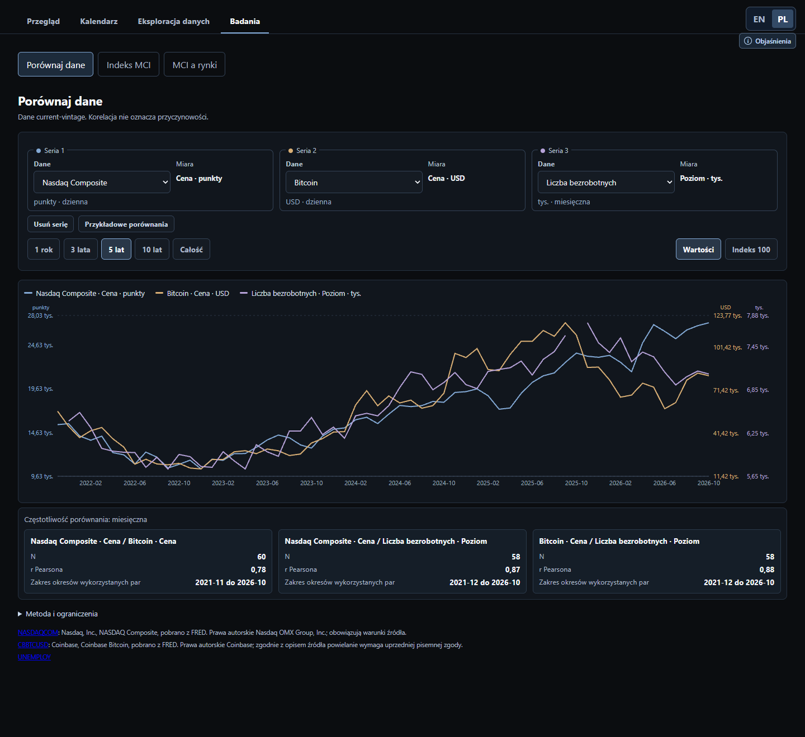
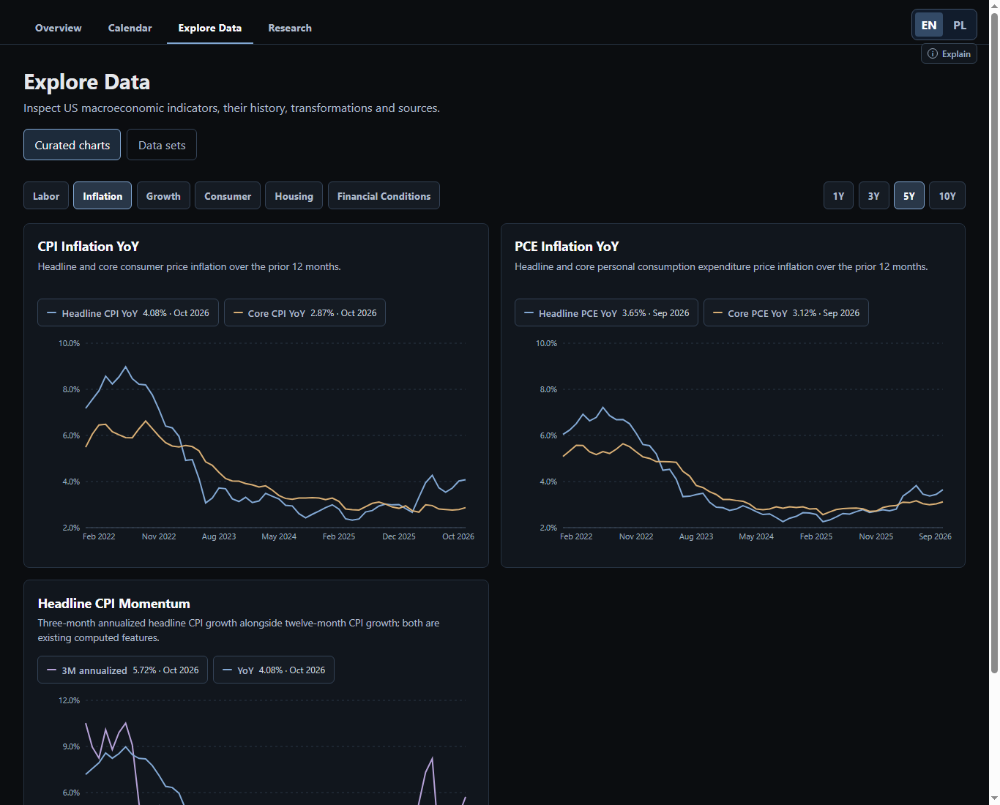
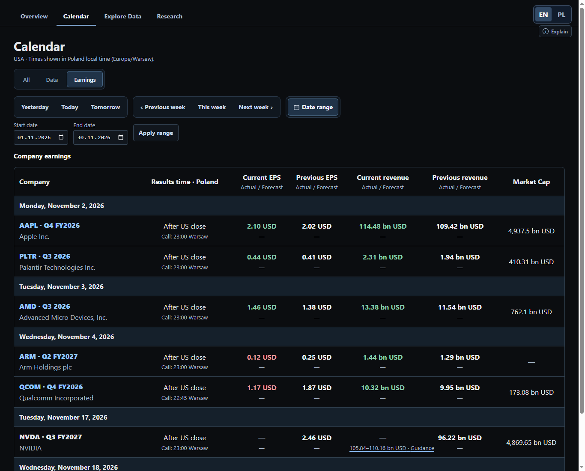
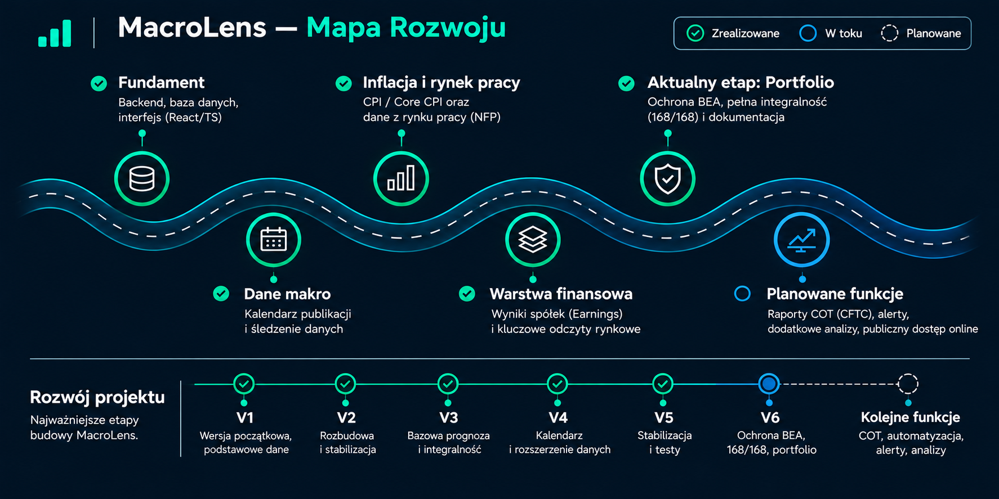
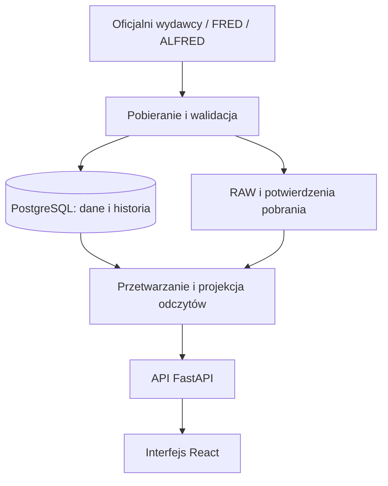

# MacroLens

**Autorski projekt do analizy danych makroekonomicznych i rynków finansowych.**

Rozwijam MacroLens z zainteresowania gospodarką, rynkami i analizą danych.
To samodzielnie stworzone narzędzie do porównywania wskaźników, badania historii
gospodarki USA oraz śledzenia publikacji makro i wyników spółek.

Python · FastAPI · PostgreSQL · React · TypeScript · Docker

[](https://github.com/pecakxkamil/macrolens/actions/workflows/ci.yml)

[Research](#research) · [Explore Data](#explore-data) · [Galeria](#galeria) · [Roadmapa](#roadmapa) · [Dokumentacja](docs/architecture.md) · [Uruchomienie](#uruchomienie-lokalne)


*Overview: rynek pracy, inflacja, wzrost, konsument, mieszkalnictwo i warunki finansowe — odczyty, poprzednie wartości i kontekst.*

## Najciekawsze możliwości analityczne

- **Zestawianie danych:** dwie lub trzy serie na jednym wykresie, wspólne okresy i osie dopasowane do jednostek.
- **Analiza dynamiki:** poziomy, zmiany m/m i r/r, średnie kroczące oraz inne transformacje dostępne dla wybranego wskaźnika.
- **Badanie zależności:** korelacja Pearsona, wielkość próby, porównania lead/lag i stabilność korelacji w czasie.
- **Syntetyczny obraz gospodarki:** eksperymentalny Macro Conditions Index (MCI) z sześcioma subindeksami i jawnym rozkładem składników.
- **Kontekst publikacji:** Actual/Previous, okres obserwacji, pochodzenie danych, rewizje i zachowane prognozy sprzed wydarzenia.

## Research

### Compare Data — własne zestawienia wskaźników

Porównanie **dwóch lub trzech serii** makro lub zapisanych cen Nasdaq i Bitcoina,
z osobnym wyborem miary i zakresu 1–10 lat albo całej historii.

Wspólny wykres pokazuje wartości w ich jednostkach lub **indeks 100** dla
kwalifikujących się dodatnich poziomów. Każda para ma **korelację Pearsona,
liczbę obserwacji i zakres próby**. Częstotliwości są wyrównywane bez interpolacji;
indeksowanie nie zmienia danych użytych do korelacji.

### MCI i MCI vs Markets — gospodarka w kontekście rynku

- **MCI Index:** opisowy indeks 0–100, sześć obszarów gospodarki, wagi i wkłady poszczególnych składników oraz historia z opcjonalnymi liniami subindeksów.
- **Dwie perspektywy historii:** bieżące zapisane wersje danych oraz odrębna rekonstrukcja point-in-time z wersji ALFRED dostępnych na historyczny koniec miesiąca.
- **MCI vs Markets:** zestawienie poziomu i miesięcznej zmiany MCI z miesięcznymi stopami zwrotu Nasdaq lub Bitcoina.
- **Lead/lag:** korelacje dla przesunięć od −6 do +6 miesięcy, okna kroczące 24 lub 36 miesięcy i wykres rozrzutu z datami oraz wartościami poszczególnych par.

**Korelacja nie oznacza przyczynowości ani zdolności przewidywania rynku.**
MCI jest eksperymentalnym wskaźnikiem opisowym, nie modelem recesji ani sygnałem inwestycyjnym.

## Explore Data

**Data sets:** wyszukiwarka i filtry wskaźników, historia pojedynczego szeregu,
aktualna i poprzednia wartość z datami, jednostki, definicja i źródło.
Do wyboru są dostępne transformacje i zakresy 1–10 lat.

**Curated charts** zawiera gotowe porównania: CPI i Core CPI, PCE i Core PCE,
realną konsumpcję i dochód, rozpoczęte budowy i pozwolenia oraz rentowności
obligacji 2Y/10Y. Są też m.in. momentum CPI i spread krzywej dochodowości.
Interaktywne legendy pozwalają ukrywać serie, a tooltipy odczytywać wartości
i daty. Własny dobór wielu serii jest dostępny w Research → Compare Data.

### Co można analizować w MacroLens?

- Jak zmienia się dynamika CPI i Core CPI, a jak krótsze momentum inflacji na tle zmian r/r?
- Jak przebiegały bezrobocie i stopa Fed w wybranym okresie oraz jak zmienia się ich opisowe porównanie po zmianie zakresu próby?
- Czy współzmienność zmian MCI i stóp zwrotu Nasdaq lub Bitcoina jest stabilna w różnych oknach i przesunięciach czasowych?

Pytania służą samodzielnej analizie, bez z góry przypisanych wyników.
Overview oferuje **raport Markdown**; Research i Explore Data nie mają eksportu CSV.

## Kalendarz publikacji i Earnings

**Calendar:** Actual/Previous, potwierdzone okresy i godziny, CPI/Core CPI,
sześć odczytów Employment z NFP oraz szczegóły z interpretacją i trendem.

**Earnings:** EPS, przychody, poprzednie okresy fiskalne i dostępne prognozy
zarządów. Historia zachowuje wcześniejsze prognozy, dostępne pierwsze odczyty
i rewizje. Nowcasty i guidance pozostają odrębne od konsensusu rynkowego.

## Galeria

Prawdziwe widoki lokalnej aplikacji z zapisanymi danymi. Obrazy są duże i ułożone
pojedynczo; [pochodzenie i warunki wykonania](docs/screenshots/README.md).

### Research — porównanie dwóch serii



*Wspólny wykres UNRATE i DFF, wybór zakresu, liczba sparowanych obserwacji i korelacja Pearsona. To opis zapisanej próby, nie wniosek o przyczynowości.*

### Explore Data — inflacja i jej dynamika



*Pięcioletnie wykresy bieżącej zapisanej historii i pochodnych. Ich definicje i wersje nie muszą odpowiadać odczytom przypisanym do publikacji w Calendar.*

### Calendar — publikacje i odczyty


*Employment i CPI: okresy, godziny, aktualne i poprzednie odczyty oraz jawne braki.*

### Earnings — wyniki spółek



*Raportowane wyniki i ich porównanie z poprzednimi okresami fiskalnymi.*

<details>
<summary>Szczegóły publikacji makro — dodatkowy widok</summary>


*Rozwinięta publikacja CPI z wyjaśnieniem metody, porównaniem i historią.*

</details>

## Roadmapa

**Ukończone:** dashboard, porównania i eksploracja danych, opisowe narzędzia
Research, kalendarz, CPI/Employment, Earnings oraz wersjonowanie historii.

**Planowane:** raporty COT (CFTC), automatyzacja kolejnych publikacji H.15/PMMS,
kolejne narzędzia Research, szersze analizy i porównania, alerty oraz opcjonalny
publiczny dostęp online. Bez deklaracji terminów i gotowości tych funkcji.



Oznaczenia V1–V6 na grafice dotyczą rewizji autoryzacji Forecast F1,
nie sześciu oficjalnych wydań całej aplikacji. Aktualny podział na ukończone
i planowane opisano powyżej.

## Technologie i architektura

| Warstwa | Technologie |
|---|---|
| Pobieranie, przetwarzanie i walidacja | Python, HTTPX, pandas, adaptery źródeł |
| Backend i API | FastAPI, Uvicorn |
| Dane i historia | PostgreSQL 17, psycopg, wersjonowane obserwacje i dokumenty |
| Interfejs i wizualizacje | React, TypeScript, Vite, Recharts |
| Testy | pytest, Vitest, Testing Library, integracja na odrębnym PostgreSQL |
| Środowisko i CI | Docker Compose, GitHub Actions |



Widoki korzystają z zapisanych danych; kontrola źródła, pobranie obserwacji
i potwierdzenie publikacji są odrębnymi etapami. Obowiązują warunki dostępu
i redystrybucji wydawców.

[Architektura](docs/architecture.md) · [Metodologia](docs/methodology.md)

## Metodologia i jakość danych

- **Okres obserwacji to nie data publikacji.** Calendar wymaga potwierdzenia powiązania; sama obecność liczby w bazie go nie zastępuje.
- **Historia może zawierać rewizje.** Explore Data i Compare Data korzystają z bieżących zapisanych wersji. Osobny tryb PIT MCI używa dostępności na poziomie dnia, nie dokładnej godziny publikacji.
- **Definicje i jednostki mają znaczenie:** SA/NSA, poziomy, pochodne oraz oficjalnie publikowane stopy zmian nie są zamienne. Braki danych nie są zastępowane zerem.
- **Statystyka ma ograniczenia.** Korelacje poziomów mogą odzwierciedlać wspólne trendy; próby, braki i daty par pozostają widoczne. Brak podstaw do wniosków przyczynowych lub rekomendacji inwestycyjnych.

[Pełne zasady, historia i wzory](docs/methodology.md).

## Testy i CI

GitHub Actions sprawdza backend pytest, frontend Vitest, TypeScript/build,
20 etapów integracji na odrębnym PostgreSQL 17 oraz integralność F1 V6
**168/168** (165 plików i 3 wersje bibliotek). Historyczne wzorce pozostają
zachowane; zielone testy funkcjonalne nie zastępują kontroli bajtów.

[Aktualne CI i polecenia lokalne](docs/ci.md) · [Zasady integralności](.github/ci/forecast-integrity.md)

## Ograniczenia

- Projekt działa lokalnie; nie ma publicznie hostowanego demo ani dołączonej pełnej bazy.
- Aktualność zależy od źródeł i uruchomionego backendu; część odświeżeń makro inicjuje widoczna karta. Brak wspólnego SLA, a dłuższe obliczenia mogą wymagać oczekiwania.
- H.15/PMMS mają potwierdzone powiązania historyczne. Kandydat automatyzacji przyszłych publikacji nie jest wdrożony.
- Pokrycie Earnings, prognoz i danych PIT jest ograniczone. Niepotwierdzone okresy, brak konsensusu, kapitalizacji lub podstawy porównania pozostają jawne.
- MCI i analizy zależności są eksperymentalne i opisowe. Nie odtwarzają strategii inwestycyjnej ani pełnej wiedzy intraday z przeszłości.

## Uruchomienie lokalne

Wymagania: **Python 3.12**, **Node.js 22/npm**, **Docker Compose/PostgreSQL 17**
oraz własny klucz FRED do pobierania danych. Polecenia poniżej są przeznaczone
dla **nowego środowiska developerskiego**, nie istniejącej bazy z danymi.

```powershell
git clone https://github.com/pecakxkamil/macrolens.git
cd macrolens
python -m venv .venv
.venv\Scripts\python.exe -m pip install -r requirements.txt
.venv\Scripts\python.exe -m pip install httpx==0.28.1 "psycopg[binary]==3.2.13" pypdf==6.21.2
Copy-Item .env.example .env
# Uzupełnij w .env wartości FRED_API_KEY i DB_*.
docker compose up -d postgres
.venv\Scripts\python.exe -m app.database.init_db
.venv\Scripts\python.exe -m app.database.sync_series
.venv\Scripts\python.exe -m uvicorn app.api.main:app --reload --host 127.0.0.1 --port 8000
```

W drugim terminalu, z głównego katalogu repozytorium:

```powershell
cd frontend
npm ci
npm run dev -- --host 127.0.0.1 --port 5173 --strictPort
```

Interfejs: [localhost:5173](http://127.0.0.1:5173/).
API: [dokumentacja](http://127.0.0.1:8000/docs) i [health](http://127.0.0.1:8000/health).

Inicjalizacja tworzy podstawowy schemat i katalog, **nie odtwarza pełnej
instancji ze screenshotów ani autoryzacji Forecast/Earnings**. Repozytorium
nie zawiera tokenów, prywatnych planów, danych RAW ani bazy. Nie kopiuj cudzych
tokenów i nie używaj APPLY jako skrótu do aktywacji.

[Pełna instrukcja lokalna](docs/local-development.md) opisuje bezpieczny przykład
pobrania jednej serii, wariant Unix, konfigurację API i ograniczenia uruchomienia.
Do obejrzenia projektu bez poświadczeń służą screenshoty i testy offline.
