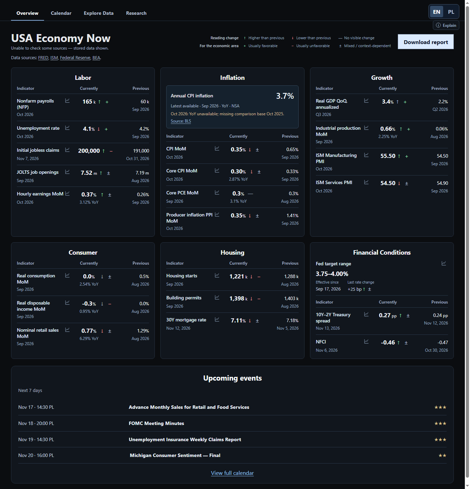
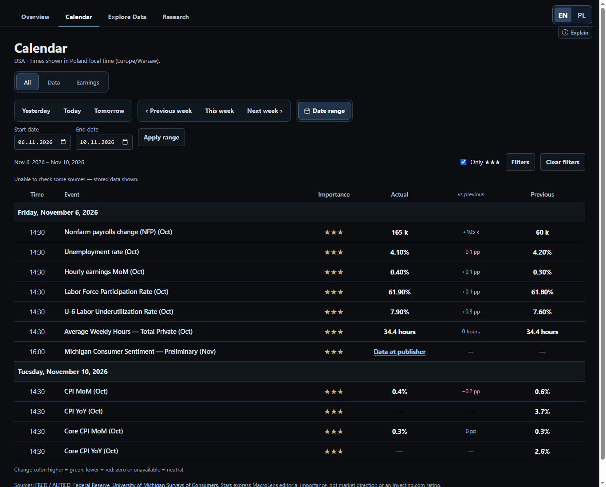
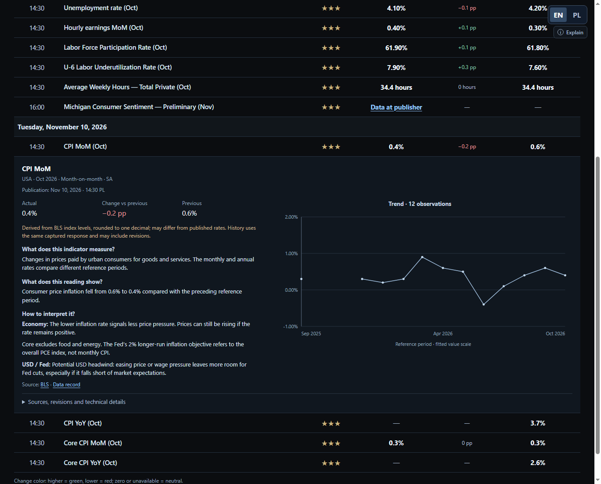
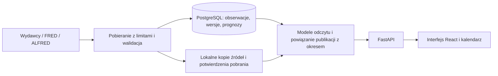

# MacroLens

[](https://github.com/pecakxkamil/macrolens/actions/workflows/ci.yml)

**Dane makro USA i wyniki spółek w jednym panelu.**

MacroLens pokazuje aktualne i poprzednie odczyty, ich historię oraz źródła.
Łączy kalendarz publikacji, prognozy i analizy w dwujęzycznym interfejsie.



**Python · FastAPI · PostgreSQL · React · TypeScript · Docker**

[Uruchomienie lokalne](#uruchomienie-lokalne) · [Dokumentacja techniczna](docs/architecture.md) · [Testy i CI](docs/ci.md)

## Możliwości aplikacji

- **Kalendarz makro:** publikacje, potwierdzone okresy i porównania Actual/Previous.
- **Inflacja i rynek pracy:** CPI, Core CPI oraz sześć odczytów Employment, w tym NFP.
- **Wyniki spółek:** EPS, przychody i porównania okresów fiskalnych.
- **Forecast F1:** nowcasty i prognozy zarządów z historią zachowaną sprzed publikacji.
- **Eksploracja danych:** sześć obszarów gospodarki, wykresy, definicje i raport do pobrania.
- **Integracje i testy:** wersjonowanie danych źródłowych, testy automatyczne i kontrola integralności w CI.

## Pozostałe widoki aplikacji

Wszystkie cztery zrzuty pochodzą z działającej lokalnej aplikacji z 16 listopada
2026 r. Pokazują zapisane dane i rzeczywiste stany kontroli źródeł, również
częściowe wyniki. Nie są transmisją na żywo ani dołączonym zbiorem danych.
Overview i Calendar mogą korzystać z różnych wersji źródłowych lub transformacji.
[Pochodzenie zrzutów](docs/screenshots/README.md).

<details>
<summary>Kalendarz, szczegóły publikacji i wyniki spółek — zobacz trzy widoki</summary>

### Kalendarz publikacji



### Szczegóły wskaźnika



### Wyniki spółek


</details>

## Technologie i architektura

| Warstwa | Technologie |
|---|---|
| Pobieranie i walidacja danych | Python, HTTPX, pandas, adaptery poszczególnych źródeł |
| API | FastAPI, Uvicorn |
| Przechowywanie danych | PostgreSQL 17, psycopg, wersjonowane obserwacje i dokumenty |
| Interfejs | React, TypeScript, Vite, Recharts |
| Testy | pytest, Vitest, Testing Library, testy integracyjne na tymczasowym PostgreSQL |
| Środowisko programistyczne i CI | Docker Compose, GitHub Actions |



Wyświetlanie korzysta z zapisanych danych. Kontrola metadanych, pobranie
obserwacji i zaakceptowanie publikacji to odrębne zdarzenia. Sama data
w kalendarzu nie potwierdza, że wartość należy do danej publikacji.
Więcej informacji: [architektura](docs/architecture.md)
i [metodologia](docs/methodology.md).

## Źródła danych i interpretacja

MacroLens korzysta z [FRED](https://fred.stlouisfed.org/)
i [ALFRED](https://alfred.stlouisfed.org/) oraz zweryfikowanych oficjalnych
dokumentów BLS, BEA, Rezerwy Federalnej, Census i innych wydawców.
Dane o zatrudnieniu i CPI mają bezpośrednie ścieżki BLS; PKB oraz dochody
i wydatki osobiste (PIO) korzystają z istniejącej integracji dokumentów BEA.
Wyniki spółek opierają się na zweryfikowanych raportach i tożsamości okresów
fiskalnych.

Obserwacje w bieżącej wersji, zarchiwizowane pierwsze obserwacje i oficjalnie
publikowane stopy zmian mają różne znaczenie. Interfejs zachowuje te
rozróżnienia, w tym SA/NSA, rewizje i brakujące podstawy porównania.
Nowcasty dostawców nie są konsensusem rynkowym, a wyniki analiz opisowych
nie stanowią rekomendacji inwestycyjnych. Obowiązują warunki dostępu
i redystrybucji poszczególnych źródeł; publiczna dostępność nie oznacza
nieograniczonego prawa do ponownego rozpowszechniania.

Kalendarz zachowuje potwierdzone okresy, godziny i pochodzenie odczytów;
rozróżnia kolejne szacunki PKB oraz rewizje. Forecast F1 stosuje granice
czasowe i niezmienne zapisy prognoz sprzed publikacji, aby późniejsza wersja
nie zastępowała tej dostępnej przed wydarzeniem.

Wyniki spółek obejmują prognozy zarządów tam, gdzie dostępne są zweryfikowane
dane. Kontrola źródeł korzysta z potwierdzeń pobrania, ograniczonych ponowień
prób i ostatnich poprawnych danych; procesy w tle wymagają jawnej autoryzacji.

## Uruchomienie lokalne

Wymagania: **Python 3.12**, **Node.js 22/npm** i **Docker Compose
z PostgreSQL 17**. Rozpocznij od nowej bazy programistycznej i własnego
klucza FRED.

```powershell
git clone https://github.com/pecakxkamil/macrolens.git
cd macrolens
python -m venv .venv
.venv\Scripts\python.exe -m pip install -r requirements.txt
.venv\Scripts\python.exe -m pip install httpx==0.28.1 "psycopg[binary]==3.2.13" pypdf==6.21.2
Copy-Item .env.example .env
# Uzupełnij w .env wartości FRED_API_KEY i DB_*.
docker compose up -d postgres
.venv\Scripts\python.exe -m app.database.init_db
.venv\Scripts\python.exe -m app.database.sync_series
```

Te polecenia inicjalizują **podstawowy schemat i katalog serii**, a nie kopię
instancji z danymi widocznej powyżej. Pobranie danych jest osobnym, jawnym
krokiem. [Instrukcja środowiska lokalnego](docs/local-development.md) zawiera
przykład dla niewielkiego zakresu danych, polecenia dla systemów Unix,
ograniczenia inicjalizacji i wskazówki rozwiązywania problemów.

Uruchom backend z głównego katalogu repozytorium:

```powershell
.venv\Scripts\python.exe -m uvicorn app.api.main:app --reload --host 127.0.0.1 --port 8000
```

W drugim terminalu:

```powershell
cd frontend
npm ci
npm run dev -- --host 127.0.0.1 --port 5173 --strictPort
```

Otwórz [interfejs aplikacji](http://127.0.0.1:5173/),
[dokumentację API](http://127.0.0.1:8000/docs)
lub [kontrolę dostępności](http://127.0.0.1:8000/health).
Frontend domyślnie korzysta z API na porcie 8000;
`VITE_API_BASE_URL` pozwala zmienić ten adres.

**Samo pobranie repozytorium nie odtwarza w pełni aktywnej instancji.**
Repozytorium nie zawiera tokenów wykonawczych, planów przypisanych do
konkretnej bazy, kopii źródeł RAW, snapshotów, prywatnych potwierdzeń ani
bazy danych. Procesy F1 i Earnings wymagają osobno zweryfikowanych schematów,
danych oraz autoryzacji. Brak aktywacji musi pozostać jawny; nie kopiuj cudzego
tokenu ani nie uruchamiaj poleceń APPLY w celu obejścia tego warunku.

Do przeglądu portfolio bez poświadczeń służą zrzuty ekranu i testy oparte na
danych testowych. Niewielką interaktywną demonstrację danych można uruchomić
według opisanego przykładu dla jednej serii. Żadne sztuczne źródło danych
produkcyjnych ani dołączona baza nie są włączane automatycznie.

## Testy i CI

```powershell
.venv\Scripts\python.exe -m pytest -q
.venv\Scripts\python.exe .github/ci/check_forecast_integrity.py --authorization-version 6
cd frontend
npm test -- --maxWorkers=2 --minWorkers=2
npm run build
```

GitHub Actions uruchamia pełne zestawy testów backendu i frontendu,
kontrolę TypeScript, build, wszystkie istniejące etapy integracji PostgreSQL
oraz kontrolę integralności bajtów V6. Testy jednostkowe korzystają z danych
testowych i blokują rzeczywiste zewnętrzne połączenia HTTP/SQL. Testy
integracyjne PostgreSQL działają na tymczasowej usłudze runnera — nie aktywują
instancji produkcyjnej. Szczegóły: [dokumentacja CI](docs/ci.md)
i [zasady kontroli integralności](.github/ci/forecast-integrity.md).

Zabezpieczenie harmonogramu BEA odrzuca publikację datowaną przed końcem okresu
obserwacji i zachowuje wcześniejsze poprawne dowody. CI niezależnie sprawdza
zatwierdzony zakres F1 V6: **165 dokładnych hashy plików + 3 wersje bibliotek =
168 artefaktów**. Historyczne mapy autoryzacji V3/V4/V5 pozostają dostępne.

## Znane ograniczenia i dalsze prace

- Brak publicznej wersji online i możliwości odtworzenia całej bazy jednym poleceniem.
- Aktualność danych zależy od dostępności źródeł, działania backendu
  i odpowiedniego mechanizmu odświeżania. Część odświeżeń makro inicjuje
  widoczna karta interfejsu.
- H.15/PMMS udostępniają obecnie zweryfikowane powiązania **historyczne**.
  Automatyczne pobieranie kolejnych publikacji jest odizolowanym kandydatem,
  **niewdrożonym w tym wydaniu**.
- Zakres prognoz i wyników spółek jest ograniczony. Niedostępny konsensus,
  kapitalizacja, brak podstawy porównania r/r i niepotwierdzone okresy
  publikacji pozostają jawnie oznaczone.
- Zmiany u wydawców, ograniczenia dostępu oraz nieaktualne lub błędne
  dokumenty mogą pozostawiać częściowy wynik kontroli przy zachowaniu
  ostatnich poprawnych danych. Projekt nie deklaruje wspólnego SLA dla źródeł.
- Eksperymentalne korelacje i wskaźnik Macro Conditions Index mają opisane
  ograniczenia metodologiczne. Dalsze prace obejmują osobno zweryfikowany,
  przenośny zestaw danych demonstracyjnych, szerszą automatyzację dowodów
  publikacji i przygotowanie środowiska wdrożeniowego.

## Roadmapa

**Ukończone:** kalendarz makro, CPI/Core CPI, Employment/NFP, wyniki spółek,
historia prognoz, ochrona harmonogramu BEA oraz dokumentacja portfolio.
Aktualna rewizja autoryzacji F1 to **V6**, z kontrolą 168/168 artefaktów.

**Planowane:** raporty COT (CFTC), automatyzacja kolejnych publikacji H.15/PMMS,
alerty, dodatkowe analizy i ewentualny publiczny dostęp online. Nie deklarujemy
terminów; automatyzacja H.15/PMMS pozostaje niewdrożonym kandydatem.


Grafika zachowuje pierwotną stylistykę i ma charakter poglądowy.
Oznaczenia V1–V6 dotyczą kolejnych rewizji mechanizmu autoryzacji Forecast F1,
nie sześciu wydań całej aplikacji. Kolory i skrótowe podpisy na grafice nie są
wiążącym statusem wdrożeń — aktualny podział na ukończone i planowane podano powyżej.
