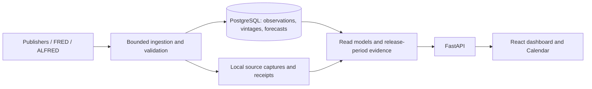

# MacroLens

[](https://github.com/pecakxkamil/macrolens/actions/workflows/ci.yml)

**A local-first dashboard for understanding US macroeconomic releases and company earnings.**

MacroLens connects source observations, release calendars and historical versions
to a bilingual analytical interface. It shows what a reading measures, which
period it describes, how it compares with the previous release and where it
came from. This repository is a portfolio project; there is no public hosted demo.

## What it does

- **Overview:** current/previous macro readings across six domains, history
  charts, source checks, explanations and a downloadable Markdown report.
- **Unified Calendar:** macro releases and earnings with Actual/Previous,
  confirmed periods, publication times, source provenance and explicit missing
  values. GDP estimate stages and revised values remain distinguishable.
- **Forecast F1:** versioned publisher nowcasts and issuer guidance, separate
  from market consensus. Pre-release cutoffs and immutable freezes retain
  the forecast available before an event rather than substituting a later one.
- **Earnings:** fiscal-period comparisons, reported EPS/revenue, previous
  results and guidance where reviewed data is available. Coverage is selective.
- **Explore Data:** indicator histories, units, transformations and source
  definitions; curated charts and an experimental research section.
- **Data integrity:** retained vintages and source receipts, bounded retries,
  last-good-data retention, and explicit authorization of background workers.

The BEA schedule guard rejects a publication dated before the end of its
observation period, preserving earlier valid evidence. CI independently checks
the approved F1 V6 boundary: **165 exact file hashes + 3 library versions =
168 artifacts**. Historical V3/V4/V5 approval maps remain available.

## Screenshots

Real captures of the populated local application, taken on 16 November 2026.
Displayed periods and source-check states describe that saved local data;
screenshots are not a live feed or a dataset distributed with the repository.

| Overview | Calendar |
|---|---|
|  |  |
| Macro detail | Earnings |
|  |  |

## Technology and architecture

| Layer | Technology |
|---|---|
| Data ingestion and validation | Python, HTTPX, pandas, source-specific adapters |
| API | FastAPI, Uvicorn |
| Storage | PostgreSQL 17, psycopg, versioned observations and documents |
| Frontend | React, TypeScript, Vite, Recharts |
| Tests | pytest, Vitest, Testing Library, disposable PostgreSQL integration tests |
| Development and CI | Docker Compose, GitHub Actions |



Rendering reads stored data. A metadata check, an observations download and an
accepted publication are separate events. A calendar date alone does not prove
that a value belongs to that release. See [architecture](docs/architecture.md)
and [methodology](docs/methodology.md).

## Data sources and interpretation

MacroLens uses [FRED](https://fred.stlouisfed.org/) and
[ALFRED](https://alfred.stlouisfed.org/) alongside reviewed official documents
from BLS, BEA, the Federal Reserve, Census and other publishers. Employment and
CPI have direct BLS paths; GDP/PIO reuse the existing BEA document integration.
Earnings rely on reviewed company reports and fiscal-period identities.

Current-vintage observations, archived first observations and official published
rates have different meanings. The UI retains those distinctions, including
SA/NSA, revisions and missing comparison bases. Publisher nowcasts are not
market consensus, and descriptive research outputs are not trading advice.
Source access and redistribution conditions still apply; public availability
does not imply unrestricted redistribution.

## Run locally

Requirements: **Python 3.12**, **Node.js 22/npm**, and **Docker Compose with
PostgreSQL 17**. Start with a fresh development database and your own FRED key.

```powershell
git clone https://github.com/pecakxkamil/macrolens.git
cd macrolens
python -m venv .venv
.venv\Scripts\python.exe -m pip install -r requirements.txt
.venv\Scripts\python.exe -m pip install httpx==0.28.1 "psycopg[binary]==3.2.13" pypdf==6.21.2
Copy-Item .env.example .env
# Edit .env: set FRED_API_KEY and your DB_* values.
docker compose up -d postgres
.venv\Scripts\python.exe -m app.database.init_db
.venv\Scripts\python.exe -m app.database.sync_series
```

This initializes the **core schema and series catalog**, not a copy of the
populated instance shown above. Data ingestion is an explicit additional step.
See [local development](docs/local-development.md) for a small-data walkthrough,
Unix commands, initialization boundaries and troubleshooting.

Start the backend from the repository root:

```powershell
.venv\Scripts\python.exe -m uvicorn app.api.main:app --reload --host 127.0.0.1 --port 8000
```

In another terminal:

```powershell
cd frontend
npm ci
npm run dev -- --host 127.0.0.1 --port 5173 --strictPort
```

Open [the UI](http://127.0.0.1:5173/), [API docs](http://127.0.0.1:8000/docs)
or [health](http://127.0.0.1:8000/health). The frontend uses API port 8000;
`VITE_API_BASE_URL` can override it.

**A fresh checkout does not reproduce the fully activated instance.** Runtime
tokens, target-bound plans, RAW captures, snapshots, private receipts and the
database are excluded. F1/Earnings workers require their separately reviewed
schemas, data and authorization. Missing activation must remain visible; do
not copy someone else's token or run APPLY commands to bypass it.

For a credential-free portfolio review, use the screenshots and fixture-backed
test suites. For a small interactive data demonstration, follow the documented
single-series walkthrough. No synthetic production feed or bundled database is
silently enabled.

## Tests and CI

```powershell
.venv\Scripts\python.exe -m pytest -q
.venv\Scripts\python.exe .github/ci/check_forecast_integrity.py --authorization-version 6
cd frontend
npm test -- --maxWorkers=2 --minWorkers=2
npm run build
```

GitHub Actions runs the complete backend and frontend suites, TypeScript/build,
all existing PostgreSQL integration stages, and the V6 byte-integrity checker.
Unit tests use fixtures and reject real external HTTP/SQL. PostgreSQL integration
tests run against a disposable runner service; they do not activate a production
instance. See [CI documentation](docs/ci.md) and the
[integrity contract](.github/ci/forecast-integrity.md).

## Known limitations and future work

- No public hosted deployment or one-click replica of the populated database.
- Data freshness depends on source availability, backend uptime and the relevant
  refresh lifecycle. Some macro refreshes are initiated by a visible frontend.
- H.15/PMMS currently expose reviewed **historical** bindings. Automatic future
  publication ingestion is an isolated candidate, **not deployed in this release**.
- Forecast and earnings coverage is bounded. Unavailable consensus, market cap,
  missing year-on-year bases and unconfirmed publication periods remain explicit.
- Publisher changes, access restrictions and stale/malformed source documents
  can leave partial checks while retaining last-good data. No universal SLA is claimed.
- Experimental correlations and Macro Conditions Index outputs have documented
  methodological limits. Future work includes a separately reviewed portable demo
  dataset, broader automated release evidence and deployment packaging.
