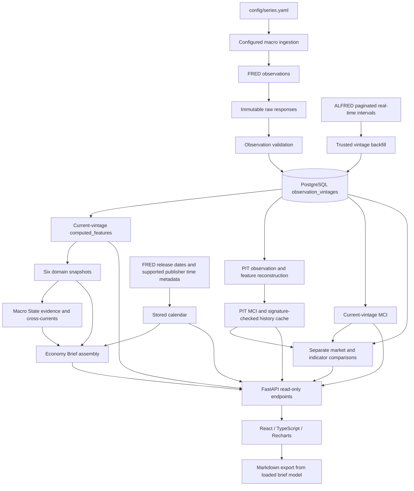

# Architecture

MacroLens is a local US macroeconomic analytics application. Its frontend is organized around an economic overview, direct data exploration and documented historical research. This is a presentation structure over existing data products; navigation does not change their methods.

## Data flow

## Backend boundaries

- `app/ingestion` retrieves configured macro and market observations, ALFRED histories and release calendars. Original responses are retained under `data/raw`; ingestion validates before storing observations.
- `app/validation` checks FRED payload structure, dates, duplicate keys and finite values. A source `.` is represented as missing.
- `app/database` owns the existing schema, configuration synchronization and connections. `observation_vintages` has a unique series/observation/vintage key. `computed_features` additionally identifies a feature, calculation as-of date and methodology version. Calendar records use their existing keys.
- `app/analytics` computes mechanical features, deterministic domain snapshots, Macro State and the assembled Economy Brief. The brief reuses these products and reports partial failures rather than inventing replacement classifications.
- Current-vintage MCI and PIT MCI remain separate analytics paths. PIT bulk-loads trusted ALFRED intervals, reconstructs observations known at each as-of date and derives features/reference distributions from those observations. Future intervals and revisions are excluded; validity ends and disappearance/missing values are respected.
- `point_in_time_mci` can persist `data/derived/mci_point_in_time_v1.json`. API reuse checks its backfill signature and date coverage; stale or missing caches fall back to reconstruction. Coverage metadata derives from actual history.
- Market comparison and macro-market lead/lag share the stored MCI/asset universe, but retain their documented alignment and sample rules. Indicator Relationships uses its own observation synchronization. They are not interchangeable statistical procedures.
- `app/api/main.py` exposes read-only HTTP endpoints. Existing `/state`, series/features/history, release, MCI/PIT/audit, comparison and brief endpoints remain available regardless of UI route changes. OpenAPI is available at `/docs`.

Configuration, ingestion, persistence, feature formulas, weights, normalization and synchronization are unchanged by the three-section frontend refactor.

## Frontend composition

`frontend/src/App.tsx` owns the three-link main navigation, hash-change subscription and shared shell. `navigation/routes.ts` resolves canonical and legacy hashes. Redirects replace the existing history entry. Explore and Research load only the selected view through React lazy loading; changing a view unmounts the previous view and preserves its existing request cancellation behavior.

| Main section | Composition | Data boundary |
| --- | --- | --- |
| Overview | `brief/EconomyBrief` shows six numeric domain cards with 17 dated MoM/level comparisons plus the official Fed target range, calendar/FOMC below, and a shared Markdown export | One assembled brief response with bounded current/previous/three-period comparisons; no PIT history request |
| Explore Data | `navigation/ExploreDataPage` switches between `IndicatorsPage` and `ChartsPage` | Existing catalog, available-feature and history endpoints; existing shared chart data/formatting helpers and `TimeSeriesChart` |
| Research | `navigation/ResearchPage` switches between `MacroIndexPage`, `MarketComparisonPage` (including `LeadLagAnalysis`) and `RelationshipsPage` | Existing independent MCI, market-comparison/lead-lag and indicator-relationship endpoints |
| Auxiliary calendar | `CalendarPage`, linked from Overview with a return link | Existing release calendar/details endpoints |

There is no separate Macro State screen. Additional indicators and their histories remain in Explore Data; Macro State classifications and their actual input windows remain in the brief API and report audit appendix. Overview cards contain numbers and dated comparisons, without classifications or per-indicator methodology blocks. `overview_readings.py` uses one shared bounded current-vintage query for 17 comparisons, including same-month YoY context for seven MoM measures and synchronized same-date Treasury spreads. `fed_target.py` reads the separately refreshed official lower/upper bound histories with a server-side cursor, validating common dates and the last continuous rate change. `readingComparisons.ts` prepares the numbers, dates, differences and presentation-only colors used by `briefModel` and the Markdown export. Export uses the loaded aggregate and does not fetch or rebuild PIT.

Monthly PIT frontend requests default to the last completed month-end in Europe/Warsaw. This avoids rebuilding unchanged completed-month history for an unused partial month when the existing cache already covers the chart. Explicit reporting end dates and current-vintage requests are preserved; scoring, alignment, lag pairing and market-price availability rules are unchanged.

English is the default/source interface language. The existing optional EN/PL preference and centralized locale-aware formatting remain supported; identifiers, URLs, API parameters and calculation bindings are not translated. No runtime translation service or AI is involved.

### Routes

- `#/` - Overview.
- `#/explore/indicators[/SERIES_ID]` and `#/explore/charts` - Explore Data views. `#/explore` defaults to the explorer.
- `#/research/mci`, `#/research/macro-market`, `#/research/relationships` - Research views. `#/research` defaults to MCI.
- `#/overview/calendar` - auxiliary full calendar; Overview remains active in main navigation.
- Old `#/state`, `#/charts`, `#/indicators[/SERIES_ID]`, `#/macro-index`, `#/market-comparison`, `#/relationships` and `#/calendar` resolve to their corresponding destinations. Unknown hashes fall back to Overview. Invalid series IDs are handled by the existing explorer state.

## Temporal semantics and interpretation

Current-vintage observations/features may contain revisions. A feature as-of date or snapshot assembly timestamp is not proof of publication availability. Overview keeps observation periods close to readings and keeps exact calculation metadata in the API, report audit appendix and detailed exploration views.

PIT MCI uses ALFRED availability dates only for its own component universe. GDP is unavailable before the applicable real-time interval even if its quarter has ended. PIT reference distributions cannot use future information. Date-level ALFRED availability does not establish intraday publication time. Missing MCI months remain gaps in research charts and statistics.

Calendar dates come from stored releases. Supported publication conventions retain `America/New_York` rather than a fixed offset; display conversion uses `Europe/Warsaw`, including unequal US/Polish DST transition dates. Unknown times remain null/unavailable. Importance colors describe importance only.

MCI is an experimental descriptive index; 50 is not a validated recession boundary. Historical correlations depend on the selected sample and do not establish causation or predictive power. See [methodology](methodology.md) for formulas, windows and endpoint semantics.

## Verification and operational limits

Pytest covers backend logic/API behavior using fixtures and mocks. Vitest/Testing Library cover UI states, data presentation, route compatibility, controls and report export; the production build type-checks and bundles the frontend. These checks do not certify economic validity or replace browser review with actual stored data.

Local development uses Docker Compose PostgreSQL, a FastAPI process and Vite. Data refreshes and PIT rebuilds are explicit commands, documented in the [README](../README.md). There is no authentication, job scheduler, report archive, PDF export, live-news integration, AI service or new deployment infrastructure.
